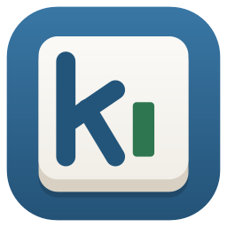
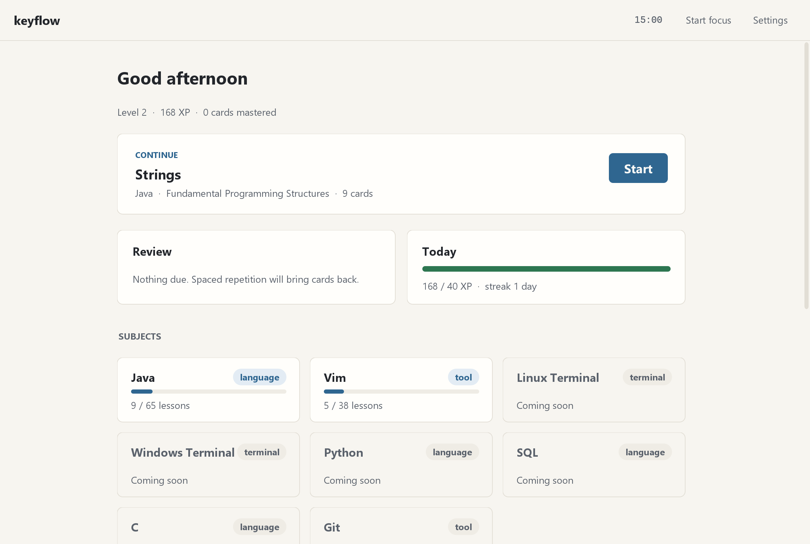
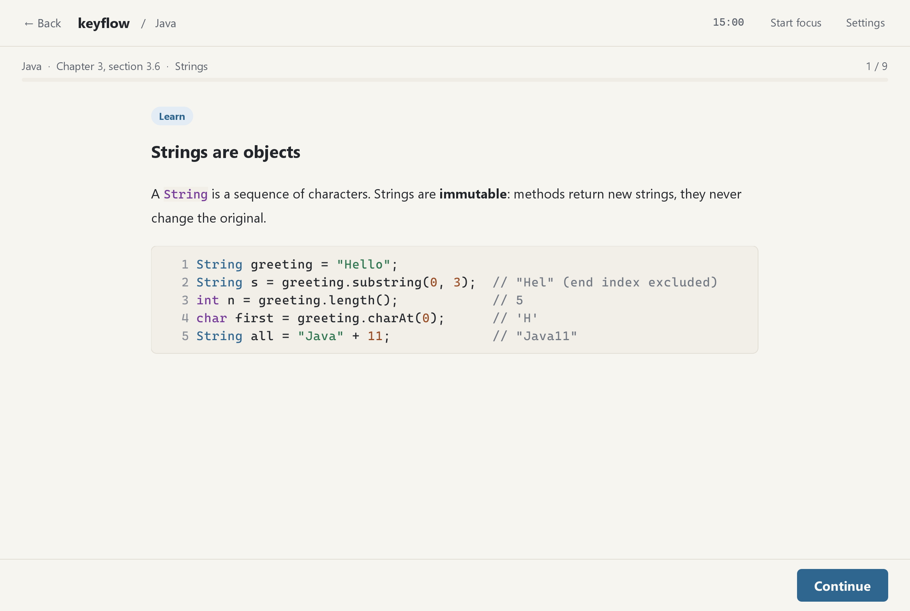
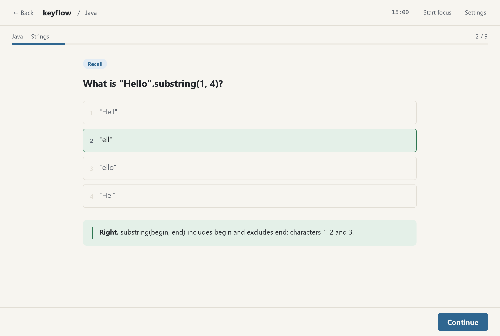
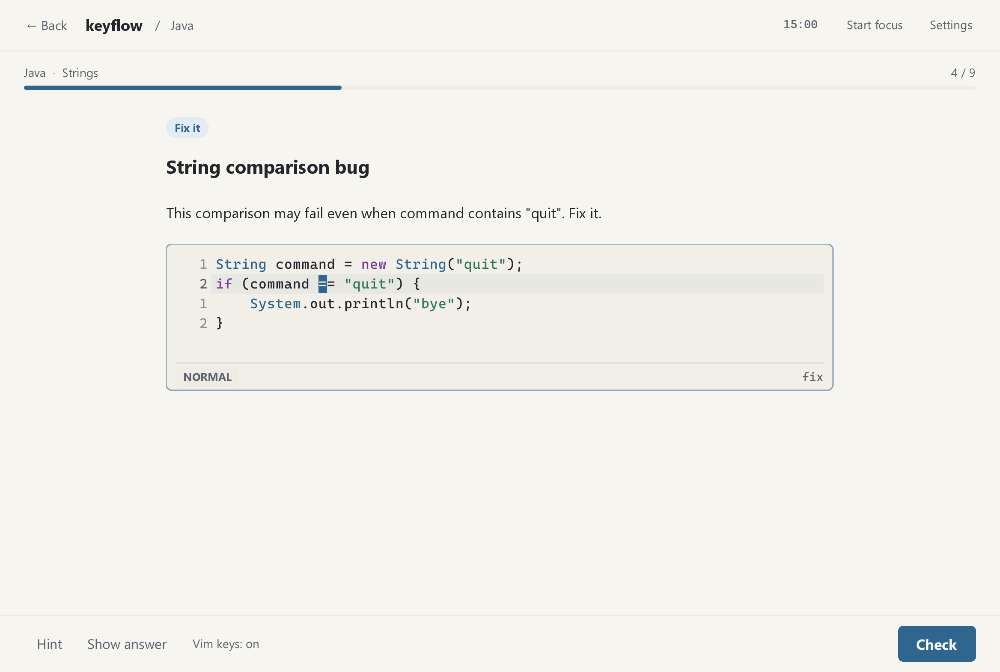
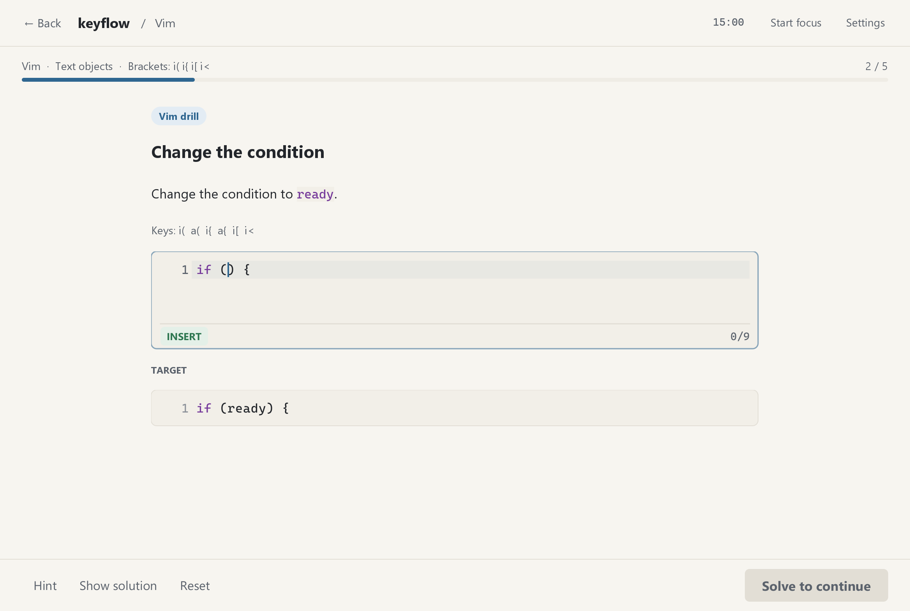
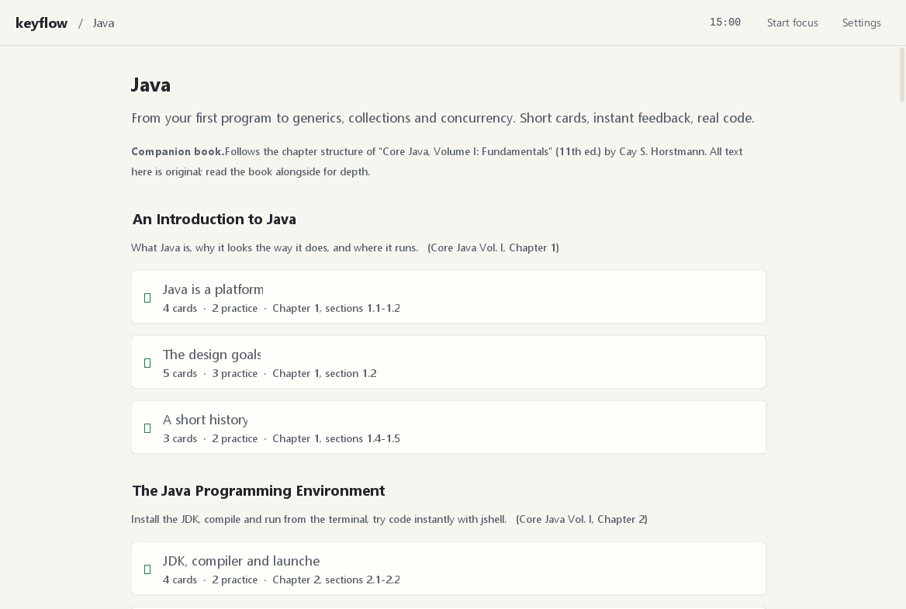
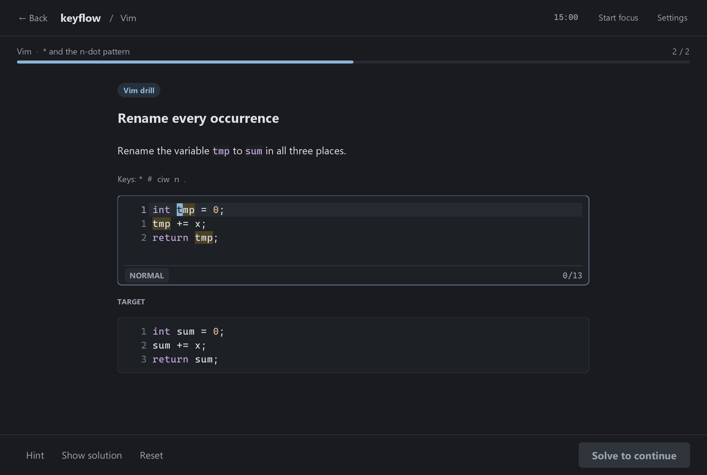
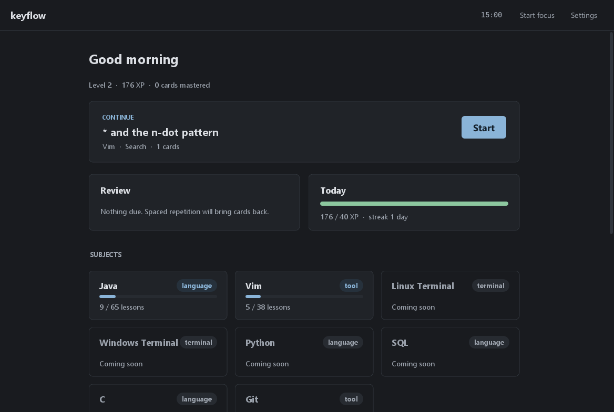

<p align="center"></p>

<h1 align="center">Keyflow</h1>

**Learn to code and edit at the speed of thought, in short, focused sessions.**

Keyflow is a free desktop app for mastering **programming syntax** and **Vim**, from your first `println` to macros and `:g/pattern/norm`. It is designed for people who find long tutorials hard to stick with (including ADHD brains): one idea per screen, instant feedback, and lots of small wins.

It runs anywhere Java runs: **Windows, macOS and Linux**.



| Learn one idea at a time | Recall it right away |
|---|---|
|  |  |
| **Fix real code, in Vim or a plain editor** | **Drill Vim on real Java** |
|  |  |
| **Watch your path turn green** | |
|  | |

<p align="center"> </p>

---

## Quick start

You need a **JDK 11 or newer** (a JDK, not just a JRE: Keyflow uses the Java compiler to check your code). Free download: [Adoptium Temurin](https://adoptium.net).

```bash
git clone https://github.com/ric4r2/keyflow.git
cd keyflow
```

**Linux / macOS**

```bash
./run.sh
```

**Windows**: double-click `run.bat` in File Explorer, or in PowerShell:

```powershell
.\run.bat
```

(`run.sh` is only for Linux and macOS. On Windows it just asks which program should open it.)

**Or build a single jar** and double-click it / run it anywhere:

```bash
./build-jar.sh          # Windows: build-jar.bat
java -jar build/keyflow.jar
```

Your progress is saved automatically after every card in `~/.keyflow/progress.properties`.

---

## What's inside

| Subject | Content |
|---|---|
| **Java** | 12 chapters, 65 micro-lessons: environment, types, operators, strings, I/O, control flow, arrays, classes, inheritance, interfaces and lambdas, exceptions, generics, collections, Swing, concurrency |
| **Vim** | 17 units, 39 lessons, 101 drills: modes, motions, operators, text objects, dot command, search, visual mode, marks, registers, macros, `:s` `:g` `:norm` `:sort`, real refactoring challenges |
| Coming soon | Linux terminal, Windows terminal (PowerShell), Python, SQL, C, Git |

**Paths** group subjects by goal: *Backend Developer*, *Embedded Systems*, *Machine Learning*, *Data Analysis*, *Terminal & Editor Mastery*.

### Card types

Each lesson is 3 to 8 minutes of small cards:

- **Learn**: one short explanation plus an example (about 60 words, never a wall of text).
- **Recall**: a quick question right after learning. Answer with the mouse or keys `1` to `4`.
- **Type it**: retype real code to build muscle memory for the syntax.
- **Fix it**: broken code with a real compiler error. Fix it.
- **Write it**: write code from a short description. It is checked by the real Java compiler.
- **Vim drill**: edit text to match a target. Scored by keystrokes against *par* (Vim-golf style).

### The Vim switch

Every code exercise can be done **with Vim keys or in a plain editor**. Toggle it at the bottom of any code card or in Settings. Use Vim mode to practise both skills at once, or switch it off to focus only on the language.

The built-in Vim engine supports normal / insert / replace / visual / visual-line modes, counts, all common motions (`w b e ge W B E 0 ^ $ f t F T ; , % { } gg G H M L`), operators (`d c y > < g~ gu gU`), text objects (`iw aw iW i" a" i' i( a( i{ a{ i[ i< ip ap`), registers (`"a`–`"z`, append, `"0`, `"_`, `Ctrl-r` in insert), undo/redo, the `.` command, macros (`q`, `@`, `@@`, recursive), marks, search with Vim regex (`/ ? n N * #`, `\< \>`, `\v`, groups), `Ctrl-a`/`Ctrl-x` and the Ex commands `:s :g :v :norm :d :y :m :t :j :sort :> :<` (including `\u \U` in replacements).

---

## How it is designed for focus

The design follows practitioner guidance on ADHD-friendly learning and interfaces (see [Research](#research)). Most of it helps everyone.

| Principle | In Keyflow |
|---|---|
| Small chunks lower the effort to start | Micro-lessons of 3 to 8 minutes; one idea per card |
| Active recall beats re-reading | A Recall question follows almost every explanation; lessons open with a warm-up question from the previous lesson |
| Immediate feedback | Every answer is checked instantly; code is compiled on the spot |
| Mastery, not punishment | Missed cards come back at the end of the lesson; no lives, no game over |
| Spaced repetition | Leitner boxes bring cards back after 1, 2, 4, 8, 16 and 32 days (**Review** on the home screen) |
| One clear next step | The home screen has one big **Continue** button; each card has one primary action (Enter) |
| External structure | Optional focus timer: 15-minute sprints with 3-minute breaks (configurable) |
| Visible progress | Each subject is a path: a rail that turns green, a checkpoint per lesson, a milestone per unit, percentages everywhere. Plus a progress bar in every lesson, streak, daily goal and XP |
| Never ahead of you | Each lesson builds only on earlier ones: tests check that no Vim drill needs a key and no Java exercise needs a construct that hasn't been taught yet |
| Interruptions are normal | Auto-save after every card; Continue resumes exactly where you stopped |
| Low distraction | No animation, no sounds except the timer, no badges or pop-ups |

### Color and type

- **Contrast first**: body text is at least **7:1** against its background (WCAG AAA) and secondary text at least **4.5:1**. The test suite checks this (`ThemeTest`).
- **No pure black or pure white**: a warm off-white "paper" light theme and a soft dark theme reduce glare.
- **One accent color**, muted and low-saturation, used only for the main action and progress.
- **Calm syntax colors**: distinguishable but desaturated.
- **Light theme by default**: research summaries report better reading comprehension on light displays. A dark theme is one click away.
- **Reading width is capped** at about 70 characters, with generous line spacing so it is easier not to lose your place.

---

## For contributors: add a language, terminal or path

All content lives in plain text under [`src/main/resources/curriculum`](src/main/resources/curriculum). No code changes are needed.

1. Add a subject to [`index.txt`](src/main/resources/curriculum/index.txt):

   ```text
   @subject python | Python | language
   desc: Pythonic syntax, data structures and the standard library.
   files: python/ch01.txt, python/ch02.txt
   ```

2. Write cards:

   ```text
   @unit P1 | Basics
   @lesson P1.1 | Variables
   @card read | Names point to objects
   text: A variable is a name bound to an object.
   code:
   x = 42
   @end
   @card quiz | What does type(3.0) return?
   option: int
   option*: float
   explain: A literal with a decimal point is a float.
   ```

   Card kinds: `read`, `quiz`, `type`, `fix`, `write`, `vim`. Code cards accept `compile: class|body|stmt|none`, `check:` regexes and one or more `answer:` blocks. Vim drills take `start:`, `target:`, `cursor:`, `goal:` and a reference `solution:` in Vim key notation.

3. Run the tests. **Every card is validated automatically**: Vim solutions are replayed and must reach the target, Java answers must compile, quizzes need exactly one correct option, and content must be progressive (a Vim drill may only use keys from the `keys:` lines of its lesson or earlier ones; a Java exercise may only use constructs an earlier Learn card has shown).

   ```bash
   ./test.sh      # Windows: test.bat
   ```

Paths are a list of subject ids: `steps: java, vim, linux, sql, git`.

Regenerate the README screenshots with `java -cp build/test-classes keyflow.ui.Screenshots` after running the tests.

### Project layout

```text
src/main/java/keyflow/
  vim/VimEngine.java      Vim emulator (modes, operators, text objects, registers, macros, Ex)
  course/                 Catalog, subjects, paths, lessons, cards, Java compile checker
  data/Progress.java      progress, spaced repetition, settings
  ui/                     Swing UI: theme, editor, home, subject map, lesson player, settings
src/main/resources/curriculum/   all course content (plain text)
src/test/java/keyflow/    engine tests, curriculum validation, contrast tests, screenshot tool
```

---

## About the Java course and the book

The Java subject **follows the chapter structure of *Core Java, Volume I: Fundamentals* (11th edition) by Cay S. Horstmann**, and each lesson names the matching book section so you can read along for depth. **All explanations, examples and exercises in Keyflow are original.** No text or code from the book is included. Keyflow is not affiliated with the author or publisher. Get the book; it is excellent.

## Roadmap

- Linux and Windows terminal subjects with a simulated shell for command drills
- Python, SQL, C and Git subjects; more paths (backend, embedded, ML, data)
- Visual block mode (`Ctrl-v`) and more Ex commands in the Vim engine
- Typing speed (WPM) statistics per symbol

## Research

The design draws on these sources. Most are practitioner guidance rather than controlled studies, so the specific choices are informed opinion, not proven rules.

- Learning Vim: [Mastering Vim Grammar](https://dev.to/iggredible/mastering-vim-grammar-1dfi), [Practical Vim tip summary](https://komputerwiz.net/practical-vim/), [Learn-Vim: Vim grammar](https://github.com/AryaFeng/Learn-Vim/blob/master/ch04_vim_grammar.md), [Vim operators](https://barbarianmeetscoding.com/boost-your-coding-fu-with-vscode-and-vim/editing-like-magic-with-vim-operators), [vimex exercises](https://github.com/spcask/vimex)
- Learning syntax: [Execute Program on spaced repetition](https://www.executeprogram.com/spaced-repetition), [Using spaced repetition to learn programming languages](https://greena13.github.io/blog/2014/08/28/using-spaced-repetition-to-learn-programming-languages), [We don't write enough code to learn it anymore](https://ricostacruz.com/posts/we-dont-write-enough-code-anymore)
- ADHD learning: [ADHD-friendly eLearning tips](https://elearningindustry.com/adhd-friendly-elearning-tips-from-instructional-designer-with-add), [Study tips for ADHD and LD students](https://www.collegexpress.com/articles-and-advice/majors-and-academics/articles/study-smarter/4-proven-study-tips-for-students-with-adhd-and-learning-differences/), [Cognitive learning and ADHD](https://oxfordlearning.com/how-cognitive-learning-empowers-students-with-adhd/)
- ADHD-friendly interfaces: [Designing for users with ADHD (University of St Andrews)](https://digitalcommunications.wp.st-andrews.ac.uk/2025/02/12/designing-for-users-with-adhd/), [ADHD-friendly web design (BOIA)](https://www.boia.org/blog/adhd-friendly-web-design-minimizing-distractions), [UI/UX and ADHD](https://www.designmonks.co/blog/ui-ux-and-adhd)
- Color and reading: [Dark mode: users and issues (Nielsen Norman Group)](https://nngroup.com/articles/dark-mode-users-issues), [Is dark mode better for coding? (Built In)](https://builtin.com/software-engineering-perspectives/dark-mode), WCAG 2 contrast ratios

## License

[MIT](LICENSE)
